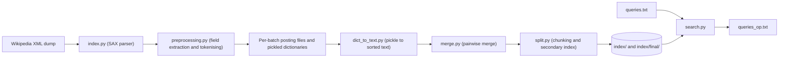

# Wikipedia Search Engine

A disk-based, field-aware inverted index and search engine for the full English Wikipedia XML dump, written in Python.


## Overview

The indexer streams a Wikipedia `pages-articles` XML dump with a SAX parser, splits every article into six fields (title, body, infobox, categories, references, external links), and writes a field-wise inverted index to disk in memory-bounded batches. The batch dictionaries are then merged into one sorted term dictionary, split into fixed-size chunks, and fronted by a small secondary index, so a query only has to open one dictionary chunk and seek directly to the posting lists it needs.

The searcher answers plain free-text queries and field-restricted queries (for example `t:world cup c:cricket`) and returns the ten best-scoring article titles per query.

According to the accompanying project report (`report.pdf`), indexing the complete ~90 GB English Wikipedia dump took about 12 hours and produced a 16.6 GB index.

## Key features

- **Streaming ingestion** of multi-gigabyte XML dumps with `xml.sax`; the dump is never loaded into memory.
- **Six-field parsing** of MediaWiki markup: title, body, infobox, categories, references and external links each get their own posting files.
- **Text normalisation**: URL stripping, punctuation removal, lower-casing, NLTK tokenisation, stop-word removal and token-length filtering.
- **Memory-bounded batching**: the in-memory index is flushed to disk whenever roughly 60 million tokens have been processed.
- **External k-way-style merge** of batch dictionaries using repeated pairwise merges of sorted text files.
- **Two-level lookup**: a secondary index of chunk boundary words, a chunked primary term dictionary holding byte offsets, and `seek()`-based access into the posting files.
- **Field-weighted ranking** and **field queries** (`t:`, `b:`, `i:`, `c:`, `r:`, `l:`).

## Architecture



*Figure 1. Indexing is a one-off batch pipeline that produces the `index/` directory. Searching is a separate step that reads queries from a file and writes ranked titles to `queries_op.txt`.*

A deeper walkthrough with sequence, state and data-layout diagrams is in [docs/ARCHITECTURE.md](docs/ARCHITECTURE.md).

## Tech stack

| Area | Choice |
| --- | --- |
| Language | Python 3 (standard library for parsing, I/O and merging) |
| XML parsing | `xml.sax` streaming parser |
| NLP | NLTK 3.7 (`word_tokenize`, English stop-word corpus) |
| Stemming library | PyStemmer 2.0.1 (imported, stemming currently disabled in code) |
| Storage | Plain-text posting files plus byte-offset dictionaries on local disk |

## Project structure

```text
.
├── index.py           # Entry point for indexing: SAX handler, batching, index writing, compression pipeline
├── preprocessing.py   # Field extraction (infobox, categories, references, links) and tokenisation
├── dict_to_text.py    # Converts pickled batch dictionaries into sorted text files in index/final/
├── merge.py           # Pairwise merge of the sorted batch dictionaries into a single file
├── split.py           # Splits the merged dictionaries into chunks and writes the secondary index
├── search.py          # Entry point for querying: plain and field queries, ranking, title lookup
├── index.sh           # Thin wrapper: python3 index.py <args>
├── requirements.txt   # nltk, PyStemmer
├── stopwords.txt      # Snapshot of the NLTK English stop-word list (reference only, not read by the code)
├── stats.txt          # Summary figures recorded from the full-dump run (first line is the index size in GB)
├── report.pdf         # Project report: index format, optimisations, full-dump time and size
└── docs/
    └── ARCHITECTURE.md
```

## Getting started

### Prerequisites

- Python 3 (verified with Python 3.11)
- A C compiler may be needed if no PyStemmer wheel exists for your platform
- Enough disk space for the index (the report's full ~90 GB dump produced a 16.6 GB index)

### Install

```bash
git clone https://github.com/Kushal7788/Wikipedia_Search_Engine.git
cd Wikipedia_Search_Engine
python3 -m venv .venv
source .venv/bin/activate
pip install -r requirements.txt
python3 -m nltk.downloader punkt stopwords
```

### Get a Wikipedia dump

Dumps are published at <https://dumps.wikimedia.org/enwiki/latest/>. The indexer reads **uncompressed** XML, so decompress first.

```bash
# Small slice of English Wikipedia (about 300 MB compressed), good for a first run
curl -O https://dumps.wikimedia.org/enwiki/latest/enwiki-latest-pages-articles1.xml-p1p41242.bz2
bunzip2 -k enwiki-latest-pages-articles1.xml-p1p41242.bz2

# Full English Wikipedia (very large; the original project indexed a ~90 GB XML dump)
# https://dumps.wikimedia.org/enwiki/latest/enwiki-latest-pages-articles.xml.bz2
```

### Build the index

Run from the directory where `index/` should be created. All paths used by the indexer and the searcher are relative to the current working directory.

```bash
python3 index.py enwiki-latest-pages-articles1.xml-p1p41242
# or
bash index.sh enwiki-latest-pages-articles1.xml-p1p41242
```

This creates `./index/` (per-batch posting and title files) and `./index/final/` (term dictionary chunks, title dictionary chunks and `word_secondary.txt`). The script prints the total build time in seconds when it finishes.

## Usage

Put one query per line in a text file, ending the file with a newline:

```text
sachin tendulkar
world cup
t:world cup i:council
b:physics t:einstein
```

Run the searcher from the same directory that holds `index/`:

```bash
python3 search.py queries.txt
cat queries_op.txt
```

For each query, `queries_op.txt` contains up to ten lines of `page_id, title` followed by the query time in seconds and a blank line. Example output from a five-article test dump:

```text
1, Sachin Tendulkar
0.0024627080420032144

2, Cricket World Cup
0.0003596249734982848
```

### Field query syntax

| Prefix | Field |
| --- | --- |
| `t:` | Title |
| `b:` | Body |
| `i:` | Infobox |
| `c:` | Categories |
| `r:` | References |
| `l:` | External links |

Fields can be combined in one query, and each field value may contain several words: `t:world cup i:2019 c:cricket`.

## How it works

**1. Streaming parse.** `WikiHandler` (a `xml.sax.ContentHandler`) toggles flags on `<title>` and `<text>` tags and accumulates character data. When a `<title>` closes, the title is appended to `index/title_<batch>.txt` and its byte offset is recorded. When `<text>` closes, the article body is handed to the preprocessor.

**2. Field extraction.** `preprocessing.pre_process_body` peels fields off the wikitext with regular expressions, in order: `{{Infobox ...}}` blocks (values after `=` on `|` lines), `[[Category:...]]` links, bulleted lines under `== References ==`, and bulleted lines under `== External links ==`. The remainder becomes the body, of which the first 45% of characters is indexed to bound index size.

**3. Normalisation.** Each field goes through the same pipeline: remove `http...` URLs, strip punctuation, lower-case, tokenise with NLTK `word_tokenize`, drop NLTK English stop words, and keep tokens of 2 to 14 characters.

**4. In-memory inverted index.** Term frequencies are counted per article and field and appended to `index_dict[term][field]` as `page_id:tf` strings. Every 10,000 pages the handler checks a running token count; once it exceeds 60 million, the batch is flushed and page ids restart at 1, so a document is identified by `(page_id, batch)`.

**5. Batch flush.** For each of the six fields, every term's postings are written as one comma-separated line to `<field>_index_<batch>.txt`, and the term's entry is replaced with the byte offset of that line. The term-to-offsets dictionary and the page-to-(title offset, token count) dictionary are pickled.

**6. Compress, merge, split.** `dict_to_text` turns each pickle into a sorted text file (`term-batch:b t e c i r`, with `n` for an absent field). `merge` repeatedly merges pairs of sorted files, concatenating the batch entries of equal terms, until one file remains. `split` cuts the term dictionary into 1,000,000-line chunks (`word_dict_fin_<k>.txt`) and writes the first term of each chunk to `word_secondary.txt`; the title dictionary is cut into 100,000-line chunks (`title_dict_fin_<k>.txt`).

**7. Query.** Query text is normalised exactly like the documents. For each term, the secondary index picks the dictionary chunk, the chunk is scanned for the term, and for every batch and field that contains it the searcher `seek()`s straight to the posting line. Scores are accumulated per `(page_id, batch)`:

`score(d) = sum over query terms and fields of tf(term, field, d) * weight(field)`

with weights title 0.75, category 0.8, infobox 0.65, references 0.4, external links 0.4 and body 0.00001. Field queries use only the named fields with weight 1 and list documents that match every field first. The top ten documents are resolved to titles through `title_dict_fin_<page_id // 100000>.txt` and a seek into `title_<batch>.txt`.

## Limitations and future work

- Ranking is field-weighted term frequency only. There is no IDF component or document-length normalisation, although per-page token counts are already stored in the title dictionary and could support it.
- Stemming is disabled: PyStemmer is imported but the stemming call is commented out, so `run` and `running` are different terms.
- Dictionary chunks are scanned line by line rather than binary-searched, so lookups cost O(chunk size) per term.
- When a word first appears in a title after it has already appeared in another field of an earlier page in the same batch, `update_index_title` replaces that word's existing postings instead of adding to them, so some non-title postings are lost.
- Field queries can list the same document twice when the "all fields matched" list is padded with the general results.
- The section parser always skips the first line after the `References` and `External links` headings (usually `{{Reflist}}`, but a bullet placed there is lost).
- Paths are relative to the working directory, and queries are read from a file rather than an interactive prompt.
- There is no automated test suite.

## Author

Kushal Shah - [github.com/Kushal7788](https://github.com/Kushal7788)
