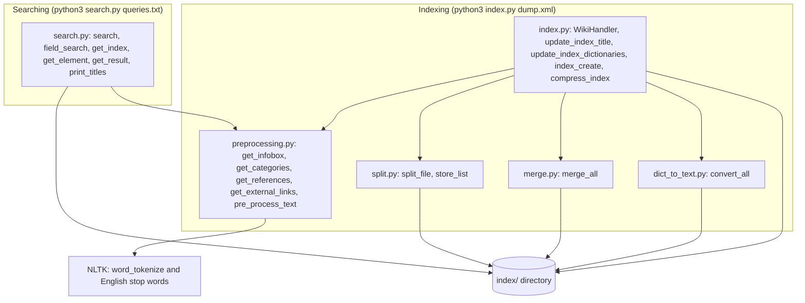
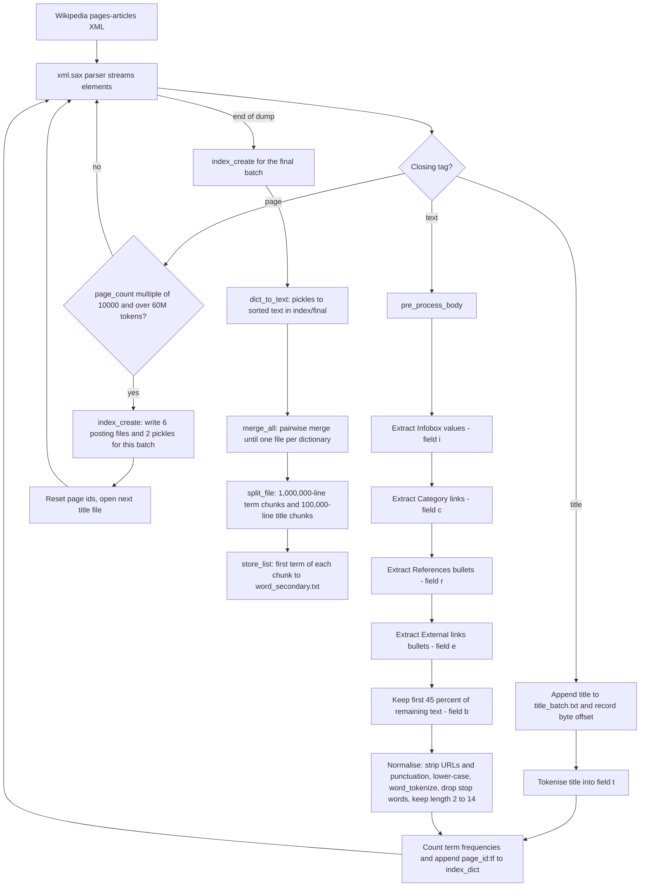
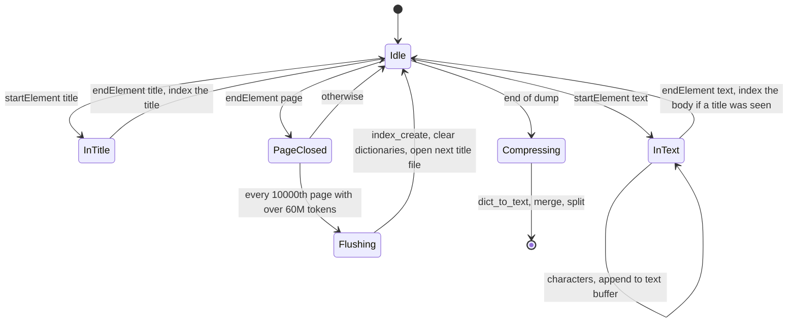
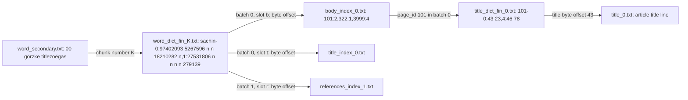
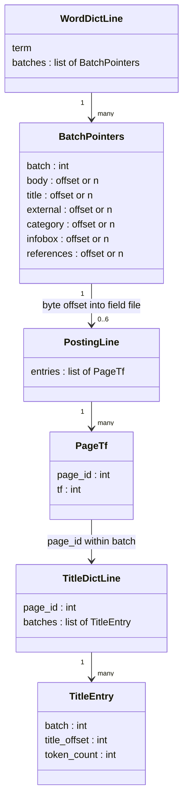
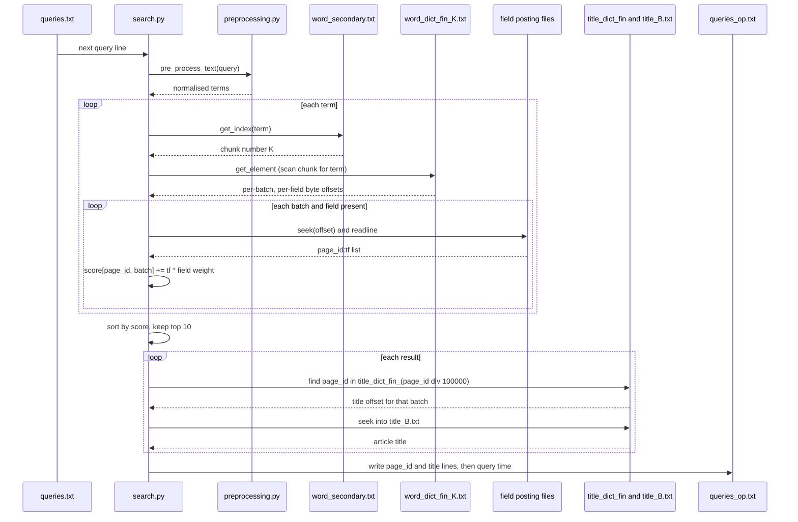

# Architecture

This document describes how the indexer and the searcher are put together, what each file on disk contains, and how a query travels through the index. All file names, constants and formats below are taken directly from the source.

- [Components](#components)
- [Indexing pipeline](#indexing-pipeline)
- [Parser state and batching](#parser-state-and-batching)
- [Index file layout](#index-file-layout)
- [Query flow](#query-flow)
- [Ranking](#ranking)
- [Complexity and resource use](#complexity-and-resource-use)
- [Known issues](#known-issues)

## Components



*Figure 1. Module dependencies. `index.py` is the indexing entry point and drives the other modules. `search.py` reuses `pre_process_text` from `preprocessing.py` so queries are normalised exactly like documents.*

The two entry points never run at the same time and communicate only through the `index/` directory. Every module resolves paths relative to the current working directory (`index/` and `index/final/`), so both commands must be run from the same directory.

## Indexing pipeline



*Figure 2. End-to-end indexing flow. The upper part runs once per article while the dump streams; the lower part (`compress_index`) runs once after parsing finishes.*

Key points:

- **Field extraction order matters.** Each extractor removes its own markup from the article text before passing it on, so infobox and category tokens are not double-counted in the body.
- **Body truncation.** `pre_process_body` keeps only `text[:int(len(text) * 0.45)]` of what remains after field extraction. This bounds the size of the body posting files, which are by far the largest.
- **No stemming.** `tokenize` accepts a `stemming` flag, but the PyStemmer call is commented out, so tokens are indexed in their surface form.
- **Per-batch page ids.** `page_count` restarts at 1 after every flush, so a document is identified by the pair `(page_id, batch)` everywhere in the index.

## Parser state and batching



*Figure 3. States of `WikiHandler`. The handler only needs the current title and text buffer plus the two global dictionaries, so memory is bounded by the batch threshold rather than the dump size.*

The token counter that drives flushing (`token_counts` in `preprocessing.py`) counts every token produced by `word_tokenize` before stop-word filtering. It is checked only on page boundaries that are multiples of 10,000, so a batch can exceed 60 million tokens by up to 10,000 pages' worth.

## Index file layout

After a full build the working directory contains:

```text
index/
├── title_<B>.txt               one article title per line, batch B
├── title_index_<B>.txt         posting lines for the title field
├── body_index_<B>.txt          posting lines for the body field
├── infobox_index_<B>.txt       posting lines for the infobox field
├── cat_index_<B>.txt           posting lines for the category field
├── references_index_<B>.txt    posting lines for the references field
├── external_index_<B>.txt      posting lines for the external-links field
└── final/
    ├── word_secondary.txt      first term of every word_dict_fin chunk, space separated
    ├── word_dict_fin_<K>.txt   term dictionary chunk K (1,000,000 lines each)
    └── title_dict_fin_<K>.txt  title dictionary chunk K (100,000 lines each)
```



*Figure 4. How the files point at each other. The secondary index selects a dictionary chunk, a dictionary line gives one byte offset per field per batch, the posting line gives `page_id:tf` pairs, and the title dictionary maps a page id to the byte offset of its title. Example lines are taken from the project report and from an index built by the original project.*



*Figure 5. Logical data model of the on-disk index.*

Line formats in detail:

| File | Line format | Notes |
| --- | --- | --- |
| `word_dict_fin_<K>.txt` | `term-B:b t e c i r[,B:b t e c i r...]` | Six slots in the fixed order body, title, external, category, infobox, references. Each slot is a byte offset into `<field>_index_<B>.txt` or `n` if the term does not occur in that field in batch B. |
| `<field>_index_<B>.txt` | `page_id:tf,page_id:tf,...` | One line per term that has that field in batch B, read with a single `seek` plus `readline`. |
| `title_dict_fin_<K>.txt` | `page_id-B:title_offset token_count[,B:...]` | Page ids are local to a batch, so one line can carry entries for several batches. `token_count` is the number of indexed tokens of the page. |
| `title_<B>.txt` | `Article title` | One line per titled page in batch B. |
| `word_secondary.txt` | `first_term_of_chunk_0 first_term_of_chunk_1 ...` | Small enough to read whole on every lookup. |

Why the merge works on text: `dict_to_text` writes each batch dictionary sorted by key, so `merge.mergeFiles` can do a classic two-pointer merge of two sorted files in constant memory. When the same term appears in both inputs, their batch entries are concatenated with a comma. `merge_all` repeats rounds of pairwise merges until a single file remains.

## Query flow



*Figure 6. Lifecycle of a plain query. Each term costs one small secondary-index read, one dictionary chunk scan, and one seek per field per batch. Results are resolved to titles only for the final top ten.*

Field queries follow the same path with three differences:

1. `get_field_query` parses `t:`, `b:`, `i:`, `c:`, `r:` and `l:` prefixes into a field-to-text map (`l` maps to the external-links field `e`). The parser drops the last character of each value, which is the next field letter or the trailing newline, so query files should end with a newline.
2. `get_result` reads only the requested field and uses a weight of 1.
3. Documents that appear in the results of every field are printed first. If there are fewer than ten of them, the list is padded with the best documents from the combined results, which can repeat a document already printed.

## Ranking

The score of a document is a weighted sum of raw term frequencies over query terms and fields:

`score(d) = sum over terms w and fields f of tf(w, f, d) * weight(f)`

| Field | Code | Weight |
| --- | --- | --- |
| Category | `c` | 0.8 |
| Title | `t` | 0.75 |
| Infobox | `i` | 0.65 |
| References | `r` | 0.4 |
| External links | `e` | 0.4 |
| Body | `b` | 0.00001 |

The very low body weight means body matches mainly break ties between documents that match in structured fields. There is no inverse-document-frequency factor and no length normalisation, although the per-page `token_count` stored in the title dictionary would allow one.

## Complexity and resource use

- **Indexing memory** is bounded by one batch (about 60 million raw tokens) plus Python object overhead.
- **Disk** for the full ~90 GB dump was 16.6 GB according to `report.pdf`, with a build time of about 12 hours.
- **Term lookup** reads `word_secondary.txt`, then scans one dictionary chunk sequentially (up to 1,000,000 lines), then performs one `seek` per field per batch. Posting lists are read in full for each matching field.
- **Title lookup** scans one 100,000-line title dictionary chunk per result, then seeks once into the title file.

## Known issues

These are behaviours of the current code, documented here rather than changed:

- `update_index_title` assigns `index_dict[k] = {'t': [...]}` when a term is already in the dictionary but has no title postings yet. This discards that term's existing body, infobox, category, reference and link postings for the current batch.
- `get_references` and `get_external_links` skip the first line after the section heading.
- `print_titles` locates a page in `title_dict_fin_<page_id // 100000>.txt`. Because the title dictionaries are merged with string comparison and then split purely by line count, some page ids end up in a different chunk from the one `page_id // 100000` points to, and their titles are then not printed.
- `title_data` is overwritten (not appended) on each SAX `characters` callback, so a title delivered in several chunks keeps only its last chunk.
